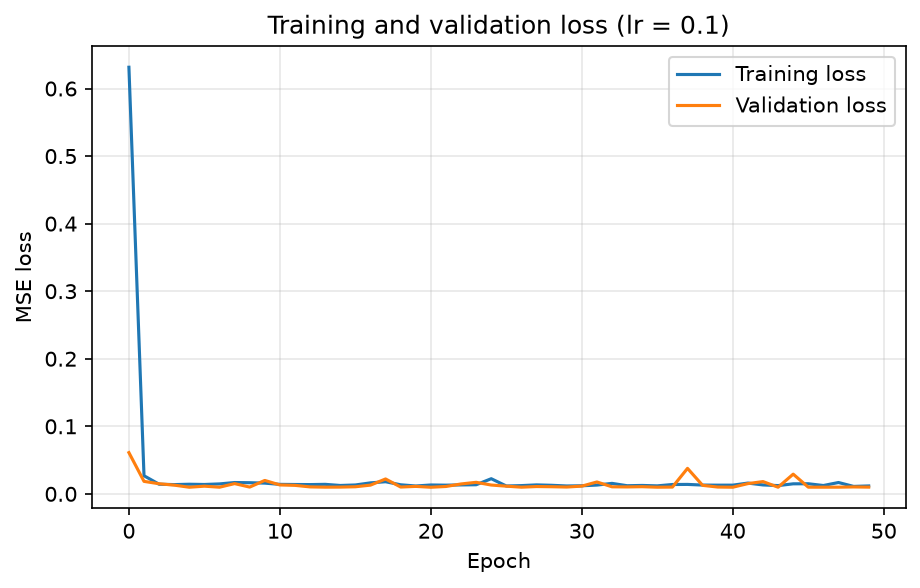
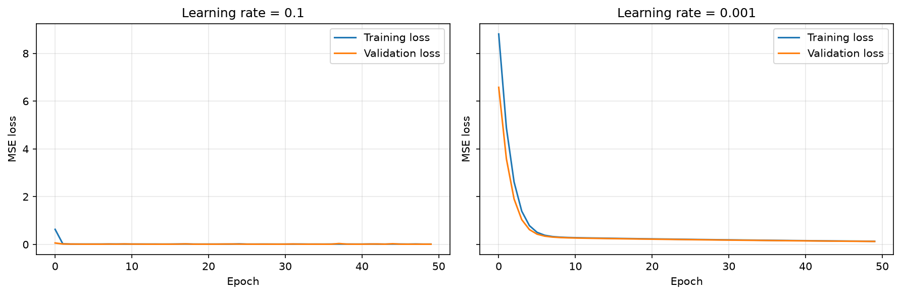
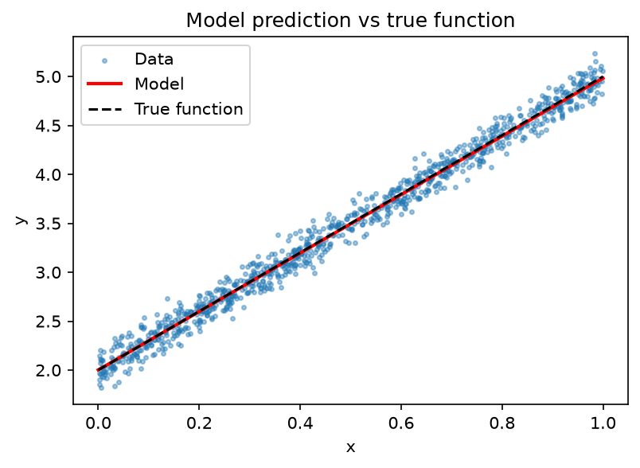

# Task 1: Understanding and Training a Neural Network

## Objective
Understand the building blocks of a neural network, practice tensor operations,
train a model on synthetic regression data, and study how the learning rate
affects training.

## Concepts
- **Neuron:** a unit that multiplies its inputs by weights, adds a bias, and passes the result through an activation function.
- **Weights:** learnable numbers that decide how strongly each input affects the output.
- **Bias:** a learnable number added to the weighted sum, which shifts the output up or down.
- **Epoch:** one full pass through the entire training dataset.
- **Batch:** a small group of samples used for one weight update. With 800 training samples and batch size 32, there are 25 updates per epoch.
- **Learning rate:** the size of each weight update. Too high and training overshoots or diverges; too low and training is very slow.

## Project files
| File | Purpose |
|---|---|
| `config.py` | All settings (data size, epochs, learning rates) |
| `tensor_ops.py` | Tensor creation, reshaping, multiplication, indexing |
| `dataset.py` | Synthetic data generation and train/validation loaders |
| `network.py` | The neural network |
| `trainer.py` | Training and validation loop |
| `visualize.py` | Plotting functions |
| `main.py` | Runs the whole task |

## How to run
    cd Week-01/Assignment
    python main.py

Plots and `results.json` are saved in the `outputs/` folder.

## Experiment setup
- Data: y = 3x + 2 + noise, 1000 samples (800 train, 200 validation)
- Model: Linear(1, 16) -> ReLU -> Linear(16, 1)
- Loss: Mean Squared Error | Optimizer: SGD | Epochs: 50 | Batch size: 32

## Results

| Learning rate | Final train loss | Final validation loss |
|---|---|---|
| 0.1 | 0.0117 | 0.0100 |
| 0.001 | 0.1308 | 0.1256 |
| 1.0 (bonus) | 11082.5 | 10975.9 |

## Conclusion
With a learning rate of 0.1 the model trained well and reached a loss of about 0.01, which matches the noise I added to the data (standard deviation 0.1, so the lowest possible loss is about 0.01). With 0.001 the loss was still about 0.13 after 50 epochs, so the model learned much more slowly and needed more epochs. With 1.0 the updates were so large that training diverged and the loss exploded to over 10,000. The training and validation losses stayed close to each other in all runs, so the model did not overfit. This showed me that the learning rate has to be large enough to make fast progress but small enough to stay stable.
