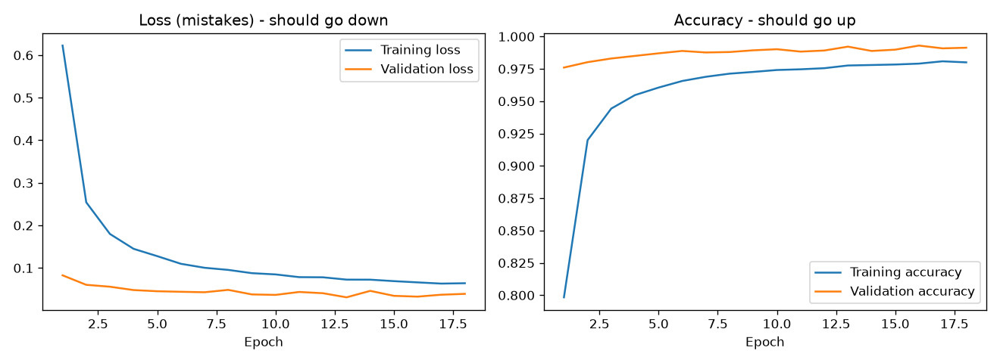
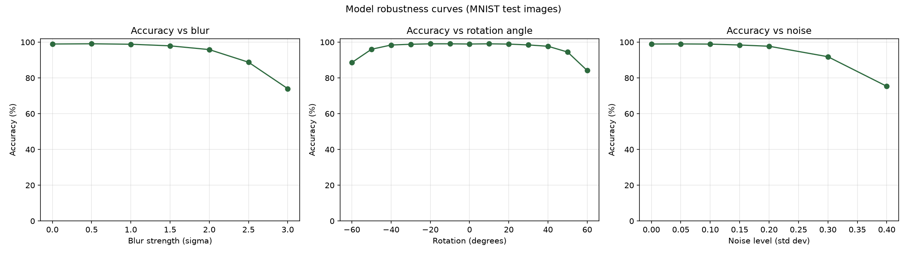
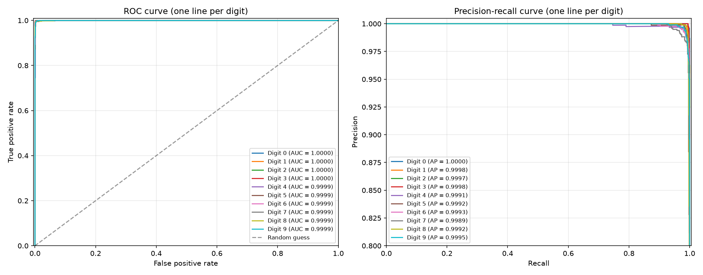
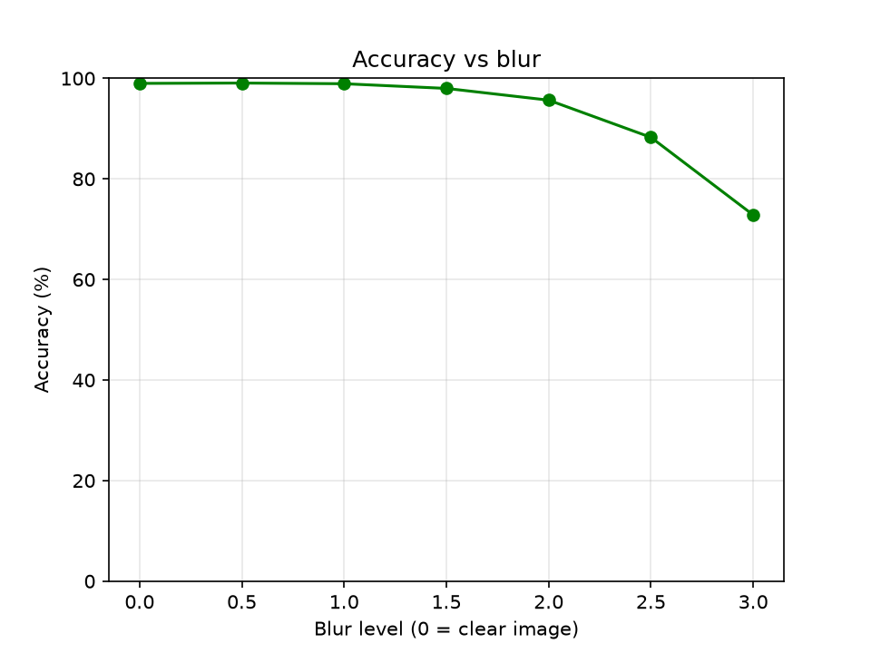
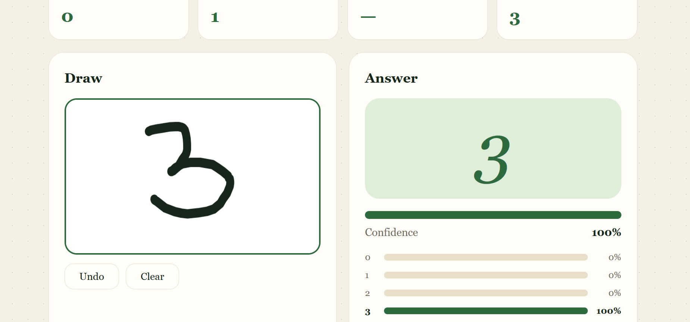

# Mini-Project: MNIST Digit Recognizer

A convolutional neural network (CNN) that recognizes handwritten digits (0 to 9), with a small web app where you draw a digit and get a prediction.

## Approach
- **Data:** MNIST (60,000 training and 10,000 test images), pixel values scaled to 0-1.
- **Model:** 4 convolution layers (32, 32, 64, 64 filters) with batch normalization, max pooling and dropout, followed by a dense layer of 256 units and a 10-way softmax output.
- **Robust training:** each training batch is randomly augmented with rotation (up to about 43 degrees), zoom, shifts, Gaussian blur, thicker strokes and noise. This helps the model handle digits drawn with a mouse, which look different from the clean MNIST images.
- **Training setup:** Adam optimizer (learning rate 0.001), batch size 128, 15 epochs, learning rate halved when validation stops improving, best model saved by validation accuracy.

## Results
- Clean test accuracy: **(fill in, e.g. 99.x%)**

## Web app

## Files
| File | Purpose |
|---|---|
| `train_model.py` | Trains the CNN and saves the best model |
| `simple_curve.py` | Generates the simple-model curve |
| `app.py` and `templates/index.html` | Web app for drawing and predicting digits |
| `model/` | Saved models and training plots |
| `screenshots/` | Images used in this README |
| `requirements.txt` | Python packages |

## How to run
    pip install -r requirements.txt
    python train_model.py
    python app.py

Then open the address printed in the terminal (for example http://127.0.0.1:5000).

## What I learned
(Write 3 to 4 sentences in your own words.)
