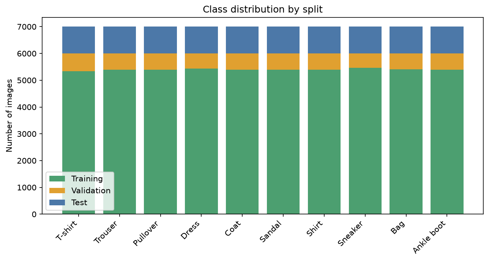
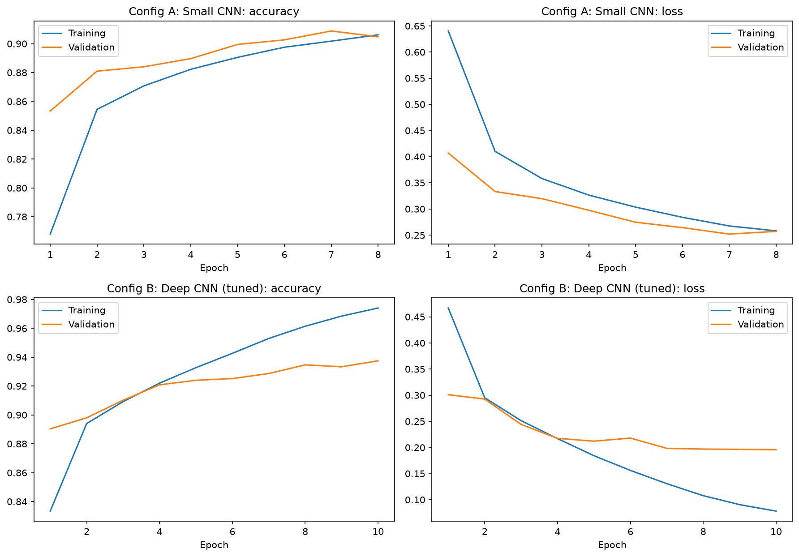
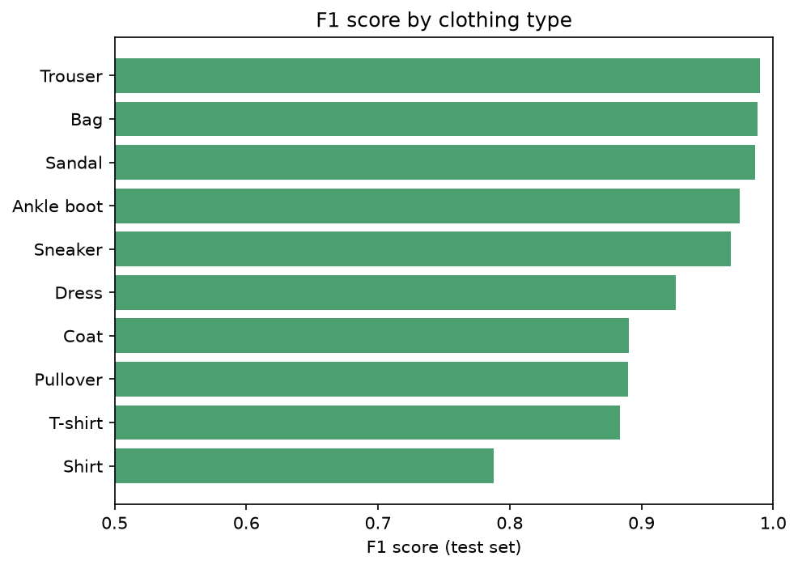
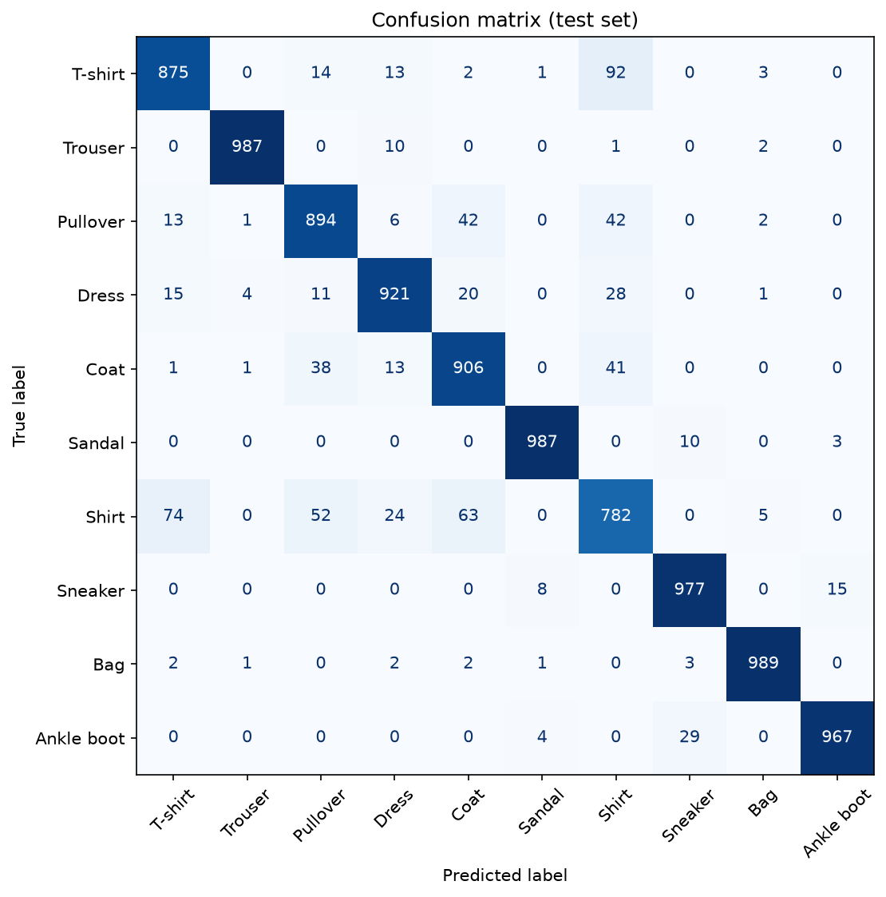
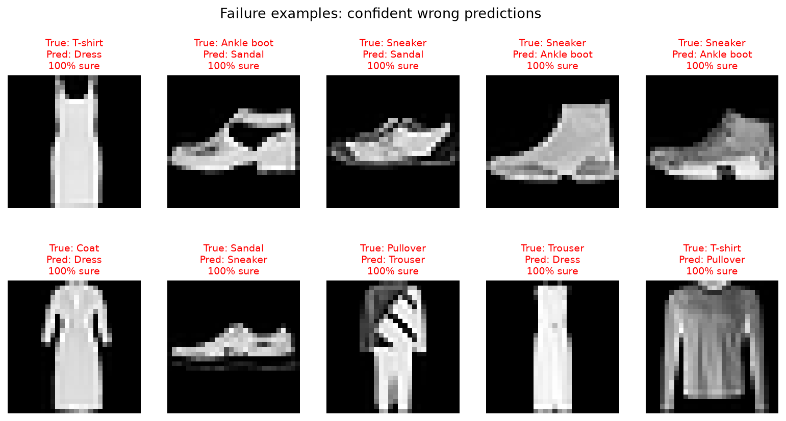

# Final Model Evaluation Report
Skill Nexis Deep Learning Internship | Week 4 | Assignment 4
Report date: 2026-10-31

## Summary

- Task: classify 28x28 grey images of clothing into 10 classes.
- Final model: **Config B: Deep CNN (tuned)**, chosen on validation accuracy.
- Final test accuracy: **92.85%** (95% confidence interval 92.34% to 93.36%), macro F1 **0.928**.
- Easiest classes: Trouser, Bag, Sandal. Hardest classes: Shirt, T-shirt, Pullover.
- 715 of 10,000 test images were misclassified.

## 1. Dataset

- **Name:** Fashion-MNIST
- **Source:** Zalando Research (Xiao, Rasul and Vollgraf, 2017), loaded with torchvision.datasets.FashionMNIST
- **Link:** https://github.com/zalandoresearch/fashion-mnist
- **License:** MIT license
- **Image format:** 28 x 28 pixels, 1 grey channel, 10 classes
- **Total images:** 70,000
- **Preprocessing:** pixels scaled to 0-1, then normalized with mean 0.286 and standard deviation 0.353.
- **Split method:** the official 60,000 training images were split at random (seed 42) into training and validation. The official 10,000 test images were kept untouched until the final evaluation.

### Split sizes

| Split | Images | Share |
|---|---|---|
| Training | 54,000 | 77.1% |
| Validation | 6,000 | 8.6% |
| Test | 10,000 | 14.3% |

### Class distribution

| Class | Training | Validation | Test | Total |
|---|---|---|---|---|
| T-shirt | 5,342 | 658 | 1,000 | 7,000 |
| Trouser | 5,389 | 611 | 1,000 | 7,000 |
| Pullover | 5,388 | 612 | 1,000 | 7,000 |
| Dress | 5,438 | 562 | 1,000 | 7,000 |
| Coat | 5,393 | 607 | 1,000 | 7,000 |
| Sandal | 5,387 | 613 | 1,000 | 7,000 |
| Shirt | 5,400 | 600 | 1,000 | 7,000 |
| Sneaker | 5,463 | 537 | 1,000 | 7,000 |
| Bag | 5,402 | 598 | 1,000 | 7,000 |
| Ankle boot | 5,398 | 602 | 1,000 | 7,000 |

The smallest class has 5,342 training images and the largest has 5,463, and the test set has exactly 1,000 to 1,000 images per class. The classes are balanced, so plain accuracy is a fair measure and no class weighting is needed.

## 2. Model configurations

### Settings

| Configuration | Network | Dropout | Learning rate | Weight decay | LR schedule | Epochs |
|---|---|---|---|---|---|---|
| Config A: Small CNN | small | 0.3 | 0.001 | 0 | none | 8 |
| Config B: Deep CNN (tuned) | deep | 0.4 | 0.001 | 0.0001 | cosine | 10 |

### Results

| Configuration | Parameters | Best epoch | Train acc | Val acc | Test acc | Time (s) |
|---|---|---|---|---|---|---|
| Config A: Small CNN | 105,866 | 7 | 0.9018 | 0.9088 | 0.9031 | 223 |
| Config B: Deep CNN (tuned) | 241,994 | 10 | 0.9740 | 0.9375 | 0.9285 | 1076 |

**Config B: Deep CNN (tuned)** was chosen as the final model because it had the higher validation accuracy (93.75% against 90.88%). On the test set it scored +2.54 points compared with Config A: Small CNN. The model was picked on validation data only, so the test score is an honest estimate.

## 3. Training and validation graphs

- **Config A: Small CNN:** at its best epoch (7), training accuracy was 90.18% and validation accuracy 90.88%, so validation is 0.7 points above training, which is normal when dropout is on during training, so the model is not overfitting.
- **Config B: Deep CNN (tuned):** at its best epoch (10), training accuracy was 97.40% and validation accuracy 93.75%, so training is 3.7 points above validation, which is a sign of overfitting.

## 4. Final test results

- **Final model:** Config B: Deep CNN (tuned)
- **Test accuracy:** 92.85% on 10,000 images (95% confidence interval 92.34% to 93.36%)
- **Macro F1:** 0.928

### Per-class results

| Class | Precision | Recall | F1 | Support |
|---|---|---|---|---|
| T-shirt | 0.893 | 0.875 | 0.884 | 1,000 |
| Trouser | 0.993 | 0.987 | 0.990 | 1,000 |
| Pullover | 0.886 | 0.894 | 0.890 | 1,000 |
| Dress | 0.931 | 0.921 | 0.926 | 1,000 |
| Coat | 0.875 | 0.906 | 0.890 | 1,000 |
| Sandal | 0.986 | 0.987 | 0.987 | 1,000 |
| Shirt | 0.793 | 0.782 | 0.788 | 1,000 |
| Sneaker | 0.959 | 0.977 | 0.968 | 1,000 |
| Bag | 0.987 | 0.989 | 0.988 | 1,000 |
| Ankle boot | 0.982 | 0.967 | 0.974 | 1,000 |

The strongest classes are Trouser (F1 0.990), Bag (F1 0.988), Sandal (F1 0.987). The weakest are Shirt (F1 0.788), T-shirt (F1 0.884), Pullover (F1 0.890).

## 5. Failure examples and suggested improvements

### Failure examples

The gallery shows the wrong predictions the model was most sure about.

| Test image # | True | Predicted | Confidence | Likely reason |
|---|---|---|---|---|
| 3531 | T-shirt | Dress | 100% | A short dress and a long T-shirt have a similar upper shape. Only the length differs. |
| 23 | Ankle boot | Sandal | 100% | Both are shoes seen from the side, and open straps can look like a boot outline in grey. |
| 8714 | Sneaker | Sandal | 100% | Both are low shoes. Straps against closed fabric is a small difference at this size. |
| 2914 | Sneaker | Ankle boot | 100% | Both are closed shoes. The height of the ankle is the main difference. |
| 4693 | Sneaker | Ankle boot | 100% | Both are closed shoes. The height of the ankle is the main difference. |

### Most common confusions

| True class | Predicted as | Times | Likely reason |
|---|---|---|---|
| T-shirt | Shirt | 92 | Both are plain upper-body clothes with almost the same outline. Buttons, collars and sleeve length are only a few pixels wide at 28x28. |
| Shirt | T-shirt | 74 | Both are plain upper-body clothes with almost the same outline. Buttons, collars and sleeve length are only a few pixels wide at 28x28. |
| Shirt | Coat | 63 | Both have long sleeves and an opening at the front, and a grey picture hides the fabric and thickness. |
| Shirt | Pullover | 52 | Both are long-sleeved tops with a similar outline. The collar or buttons that tell them apart almost disappear at this size. |
| Pullover | Coat | 42 | Both are heavy long-sleeved tops. The zip or buttons that make a coat are tiny in the picture. |

### Confidence check

- Average confidence on correct predictions: 97.1%
- Average confidence on wrong predictions: 75.8%
- If the model only answers when it is at least 90% sure, it answers 87.0% of the images with 97.54% accuracy. The rest could be sent to a person to check.

### Suggested improvements

1. **Train longer with a learning-rate schedule and early stopping.** Several runs were still improving at their last epoch.
2. **Add targeted augmentation.** Small shifts and flips give the model more variety. Combine it with longer training, because short runs may not show the benefit.
3. **Use higher-resolution or colour images.** The weakest classes (Shirt, T-shirt, Pullover) differ in details such as collars, buttons and straps that are only a few pixels wide at 28x28.
4. **Ensemble several models.** Averaging the predictions of a few networks trained with different seeds usually adds a little accuracy and steadies the results.
5. **Try transfer learning.** A network pretrained on a large image set, fine-tuned on resized images, can pick up finer detail.
6. **Collect more examples of the hard classes and check their labels.** Some pictures of Shirt, T-shirt, Pullover are ambiguous even for a person.
7. **Use the confidence threshold in practice.** Let the model answer when it is sure and pass unsure cases to a human.

## 6. Conclusion

The Config B: Deep CNN (tuned) reached 92.85% test accuracy on Fashion-MNIST with a macro F1 of 0.928. It recognises footwear, trousers and bags very well. Most errors happen between similar tops (Shirt, T-shirt, Pullover), where the difference is a few pixels of detail. The next steps with the best chance of helping are higher-resolution inputs, longer training and an ensemble.
